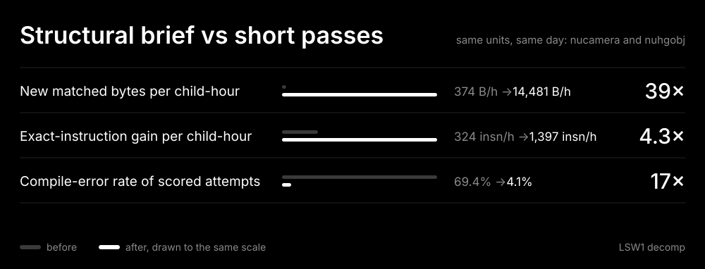

# Workflow metrics

Workflow changes have moved matching speed, so each change is measured: one number before
it and one after. `tools/workflow_metrics.py` computes eight metrics from the bench event
logs that matching already writes. [Improve the workflow as you
go](sprint_workflow.md#improve-the-workflow-as-you-go) says how a fix records its before
and after numbers; [workflow gaps](workflow_gaps.md) ranks the open gaps by the metric
each one moves.



## Commands

```sh
python3 tools/workflow_metrics.py report                  # one row per discovered run
python3 tools/workflow_metrics.py report --since 2026-11-12T18:00-08:00 --json
python3 tools/workflow_metrics.py cohorts                 # cohorts in config/workflow_metrics.toml
python3 tools/workflow_metrics.py compare --svg docs/img/workflow_metrics.svg
python3 tools/workflow_metrics.py archive                 # keep logs past worktree cleanup
```

Logs are discovered in this checkout, every listed worktree, the sibling directories of
the worktree parent and `<bench cache>/events/` (`~/.cache/lsw1/bench/events/`). When
the same run id turns up in several places, the longest log is used.
`sprint_bench.py finish` archives the run's log there. `archive` copies every log it
finds, so run it before a cleanup day.

A **cohort** in [`config/workflow_metrics.toml`](../config/workflow_metrics.toml) is a
list of run segments. A segment is one run id, cut to an optional `[since, until]`
window when one checkout's log holds several agents' work, for example a child replaced
mid-run. A **comparison** names a before cohort and an after cohort, plus the metrics
to show.

## Sources

| Event | Written by | Fields |
|---|---|---|
| `start` | `sprint_bench.py start` (via `kickoff.py --start`) | `run_id`, `model`, `item`, `lane` |
| `score` | `score_fn.py` on every attempt, while a run is open | `name`, `verdict` (MATCH, MISMATCH, ERROR), `exact`, `target`; from 2026-11-13 also `source`, `seconds`, `codegen` |
| `time` | `sprint_bench.py time LABEL -- CMD`, the finish build | `label`, `seconds` |
| `finish` | `sprint_finish.py` | `verified`, `new_verified(_bytes)` ([gap 10](workflow_gaps.md#10-verification-counts-were-mistaken-for-new-progress)), `parked`, `active_seconds`; from 2026-11-13 also `parked_names`, `deferred_names` |

The new `score` fields work as follows:

- `source` is `manual` unless a search tool set `LSW1_BENCH_SOURCE`.
  `variant_search.py` and `order_search.py` set it, so search attempts are kept apart
  from hand edits.
- `seconds` is `score_fn.py`'s wall time.
- `codegen` is the first 12 hex digits of the SHA-1 of the compiled function's bytes.
  Two candidates with the same hash are one hypothesis to the compiler.

The events have limits:

- A score event with `target` 0 and no ERROR is a unit-test stub (the old
  `test_no_queue_skips_queue_mutation_after_verifying` wrote `f MATCH 0 0` into open
  runs; it is patched out now). It is not counted.
- Sweep scoring uses `--no-queue` and writes no events. Sweep matches therefore do not
  appear here; `sweep_report.py` measures them.
- Hillclimb ledgers and permuter runs are not read. Hillclimb scores through
  `score_fn.py` or `verify_fn.py`, so its candidate attempts are already logged.
- An event's `MATCH` is `score_fn.py`'s strict verdict at the time. It is not the final
  `sprint_finish.py` verification.

Metrics that need a field older logs lack read as **unknown**. Logs written before
2026-11-13 lack those fields, and the tool never estimates the value.

## Metrics

**Active time** in a segment is the sum of the gaps between consecutive events,
counted from `since` (or the start event). Each gap is capped at the 15-minute sprint
idle cap. A function is **converted** when its first score in the segment was not
MATCH and a later one was. A function first scored as MATCH is a reverification, not
new work. Function **bytes** are the target's instruction count × 4.

| Metric | Definition and computation | Why it is actionable | Better |
|---|---|---|---|
| Matched bytes per child-hour | Bytes of converted functions ÷ active hours, summed over the cohort | The outcome. Every other metric is a cause of it | higher |
| Exact-instruction gain per child-hour | Σ over functions (best exact − first exact) ÷ active hours | Shows progress on functions that did not match yet, so a short run still has a signal | higher |
| Compile-error rate | ERROR scores ÷ all scores, split by `source` | An ERROR candidate tests no hypothesis. A high rate means a search was seeded with source that does not compile, or the types are missing | lower |
| Distinct candidates per unfinished function | Median over unmatched functions of distinct `codegen` hashes. Older logs use distinct exact counts, a labelled lower bound | Says whether a park is credible. The floor is 25 distinct compiled candidates | higher |
| Start to first compiling score | Median of (first non-ERROR score − segment origin) | Measures setup: build, task pack, draft, types | lower |
| Park recovery rate | Unmatched functions left by the cohort that any later run matched ÷ unmatched functions | Measures premature parks. A function a later pass matched quickly was not a plateau | lower |
| `score_fn` latency | Median `seconds` of score events | The cost of each hypothesis | lower |
| Build latency | Median of `time` events whose label contains `build` | The cost of finishing | lower |

Park recovery depends on what has happened since, so it can rise as later runs match
more functions. Compare it only across cohorts measured on the same day.

## Baseline, 2026-11-12

`python3 tools/workflow_metrics.py cohorts` gives:

| Metric | recent-2026-11-11 (17 runs, 7.86 h) | sol-short-2026-11-12 (8 segments, 1.35 h) | opus-brief-2026-11-12 (2 segments, 0.67 h) |
|---|---:|---:|---:|
| Matched bytes per child-hour | 5,784 B/h (117 fn, 45,456 B) | 374 B/h (3 fn, 504 B) | 14,481 B/h (7 fn, 9,744 B) |
| Exact-instruction gain per child-hour | 411 insn/h | 324 insn/h | 1,397 insn/h |
| Compile-error rate | 47.1% (23,053 / 48,978) | 69.4% (727 / 1,048) | 4.1% (12 / 291) |
| Distinct candidates per unfinished function (proxy) | 1 | 2 | none unfinished |
| Start to first compiling score | 100 s | 88 s | 26 s |
| Park recovery rate | 2.1% (3 / 144) | 52.9% (9 / 17) | none unfinished |
| `score_fn` latency | unknown | unknown | unknown |
| Build latency | 0.9 s | 0.8 s | unknown |

The per-run `report` gives a few more figures:

- The runs that relied on variant search had compile-error rates of 91–94%: hvqm4,
  nutexanm, the first nucamera pass and nuportal. In nuportal, `NuAnimCurveEval` alone
  had 684 ERROR scores out of 724.
- The median distinct-candidate count for unfinished functions is 1–10 in every run,
  far below the floor of 25.

### Structural brief vs short passes

The comparison covers the same checkouts on the same day, nucamera and nuhgobj.

- **Before:** Codex Sol children ran 10–13-minute passes with the generic brief.
- **After:** Opus children ran 17–25-minute passes with the structural-recovery brief:
  recover struct and pointer layout from the target assembly, diff by asm block, and
  try at least 25 distinct hypotheses before a plateau.

| Metric | Before → after | Change |
|---|---|---|
| New matched bytes per child-hour | 374 B/h → **14,481 B/h** | 39× |
| Exact-instruction gain per child-hour | 324 insn/h → **1,397 insn/h** | 4.3× |
| Compile-error rate of scored attempts | 69.4% → **4.1%** | 17× |

Caveats:

- The change is confounded. The model, the brief and the pass length all changed, and
  the Opus children started from the Sol children's partial drafts.
- The thread reported 6 matches and 928 B for the Sol batch. Three of those functions
  were already MATCH on their first scored attempt in the log, so they count as
  reverifications here. On the thread's figure, the before value is about 688 B/h and
  the change is about 21×.
- Start to first compiling score (88 s → 26 s) is left off the card. The Opus children
  resumed checkouts that already had builds and drafts.

The Opus fixes came from recovering types and layout, not from tuning registers:

- the size of a local `struct nuvec_s`
- a scales pointer formed from `&m`
- float reuse
- literal floats instead of rodata labels
- the donor's argument order

The 52.9% park recovery shows the Sol parks were premature.

## Recording a change

1. Before changing the workflow, find the runs it will affect and note the current value
   of the metric the change should move (`report`, or a cohort).
2. After the change, add a cohort for the runs that used it and a `[[comparison]]` to
   `config/workflow_metrics.toml`.
3. Put `compare`'s Markdown row in the PR. Regenerate the card when the comparison is the
   headline one.
4. State what changed besides the workflow (model, units, starting drafts). If a change
   moved the wrong metric, record that too.
